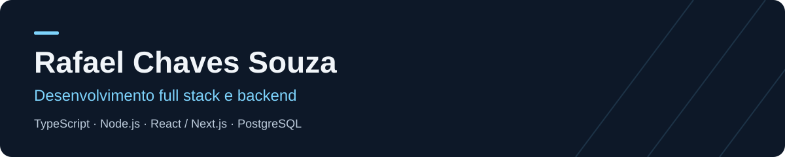

<picture>
  <source media="(prefers-color-scheme: light)" srcset="assets/header-light.svg">
  
</picture>

  <a href="https://rafasmk.vercel.app">Portfólio</a> ·
  <a href="https://www.linkedin.com/in/rafael-chaves-souza-a856b524b/">LinkedIn</a> ·
  <a href="mailto:rafael012chavess@gmail.com">E-mail</a>

## Sobre mim

Sou desenvolvedor full stack na **OTicket**, em Franca, SP, e estou concluindo o 6º semestre de **Engenharia de Software no Uni-FACEF**.

Trabalho com **JavaScript/TypeScript, React/Next.js, Node.js/Express e PostgreSQL**, desenvolvendo e mantendo aplicações web, APIs e integrações. Também contribuo com testes automatizados, análise de logs e correção de problemas.

Em projetos pessoais e acadêmicos, exploro **Python, FastAPI e IA aplicada**: recuperação de informações, agentes com ferramentas e integração de modelos locais a aplicações.

## Experiência profissional

- Desenvolvimento de interfaces web e APIs REST.
- Integração entre aplicações e manutenção de funcionalidades administrativas.
- Testes automatizados, análise de logs e investigação de problemas.
- Colaboração com a equipe na evolução das aplicações e manutenção do código.

## Projetos selecionados

<table>
  <tr>
    <td width="50%" valign="top">
      <h3><a href="https://github.com/RaFaSMK/project-products">Project Products</a></h3>
      
Dois serviços para autenticação e produtos, com cadastro público de usuários comuns, JWT/RBAC, métricas e testes de regressão da autenticação.

      
<strong>NestJS · TypeScript · MongoDB · Docker · Jest</strong>

    </td>
    <td width="50%" valign="top">
      <h3><a href="https://github.com/RaFaSMK/mini_pedidos">Sistema de pedidos</a></h3>
      
Desafio técnico full stack com clientes, produtos, pedidos, documentação de API e testes de integração para clientes.

      
<strong>TypeScript · Express · Next.js · Prisma · PostgreSQL</strong>

    </td>
  </tr>
  <tr>
    <td width="50%" valign="top">
      <h3><a href="https://github.com/RaFaSMK/gallery">Gallery Plus</a></h3>
      
Galeria de fotos e álbuns com API própria e consumo de API externa. Interface com filtros, detalhes e estados de carregamento.

      
<strong>React · TypeScript · Fastify · TanStack Query</strong>

    </td>
    <td width="50%" valign="top">
      <h3><a href="https://github.com/RaFaSMK/IOT">Quadra Inteligente AIoT</a></h3>
      
Projeto acadêmico em grupo: telemetria em tempo real, comandos, alertas e assistente local. Sensores simulados e modelos avaliados em dados sintéticos.

      
<strong>FastAPI · Vue/TypeScript · RabbitMQ · MQTT · Docker</strong>

    </td>
  </tr>
  <tr>
    <td width="50%" valign="top">
      <h3><a href="https://github.com/RaFaSMK/artefact-ai-engineer-challenge">Agente de atendimento</a></h3>
      
Protótipo de desafio técnico com chat, API e CLI. Consulta catálogo, pedidos e políticas de uma loja fictícia por ferramentas tipadas, com fontes e avaliação documentada.

      
<strong>Python · FastAPI · LangChain · Ollama · SQLite</strong>

    </td>
    <td width="50%" valign="top">
      <h3><a href="https://github.com/RaFaSMK/RAG">Pipeline RAG</a></h3>
      
Ingestão e divisão de documentos, embeddings, recuperação vetorial e geração com modelo local. CLI e testes com mocks.

      
<strong>Python · LangChain · ChromaDB · Ollama · pytest</strong>

    </td>
  </tr>
</table>

## Tecnologias e contexto

| Contexto | Tecnologias |
| --- | --- |
| Desenvolvimento profissional | JavaScript/TypeScript, React, Next.js, Node.js, Express, PostgreSQL e SQL. |
| Integrações e qualidade no trabalho | Jest e Git. |
| Prática em projetos | NestJS, Python/FastAPI, Docker/Compose, MongoDB, RabbitMQ e MQTT. |
| IA aplicada em projetos | RAG, LangChain, ChromaDB, Ollama, ferramentas e saídas estruturadas. |

Outros trabalhos: [Equaly, plataforma acadêmica de inclusão](https://github.com/RaFaSMK/PI-Equaly), [automação de sobreaviso em Python](https://github.com/RaFaSMK/Automacao_Sobreaviso), [Hustle Tracker em React Native](https://github.com/RaFaSMK/hustle-tracker) e [estudo estatístico do Titanic](https://github.com/RaFaSMK/Titanic).

## Formação e idiomas

**Engenharia de Software · Uni-FACEF** — conclusão prevista em dezembro de 2027.

Português nativo · Inglês intermediário.

Tenho interesse em oportunidades de **desenvolvimento full stack e backend**, principalmente remotas.
